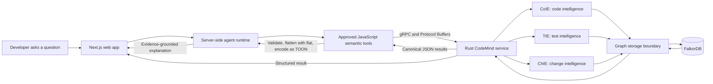
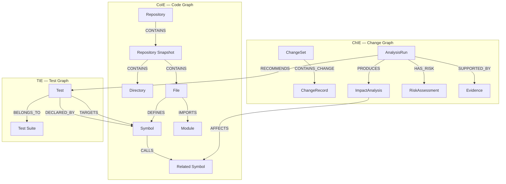
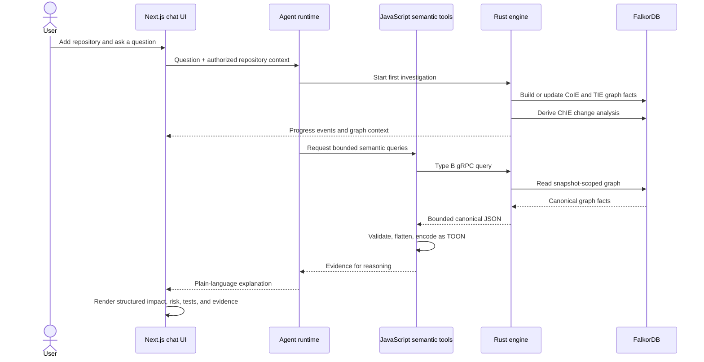

# CodeMind: Understanding Code Changes Through Connected Graphs

Software changes rarely stay inside one file. A function may be called from several modules, a type may shape an API, and tests may be associated with code far from the point where a developer starts. In a large or unfamiliar repository, finding those connections by hand takes time—and a language model should not be asked to invent them.

**CodeMind is a local codebase investigation app that builds a graph from a repository and uses that graph to answer questions about code relationships and proposed changes.** Ask a question in plain language, such as “What could change if I add a new engine?”, and CodeMind gathers bounded graph evidence before asking its agent to explain the result.

The separation of responsibilities is intentional: Rust owns canonical code, test, and change facts; FalkorDB stores the graph; and the Next.js app handles the interface, agent, and approved semantic tools.

## System architecture



There are three running services in a local setup: FalkorDB, the Rust engine, and the Next.js app. CoIE, TIE, and ChIE are modules in the Rust service; they are not separate microservices. Neither the browser nor the Next.js application connects directly to FalkorDB.

### Two representations of a result

Rust Type B functions read or analyze existing graph state and return bounded canonical JSON. The JavaScript semantic-tool layer validates the response and creates a model-facing copy by flattening it with the `flat` package and encoding that flattened representation with TOON. The UI continues to receive structured result data; TOON is only for the agent's context.

```text
Rust Type B query
      │
      └── canonical structured JSON
              ├── validate → structured UI data
              └── bounded projection → flat → TOON → agent
```

This keeps the language model in the role of interpreter: it can explain returned evidence, but it cannot turn its explanation into a new graph fact.

## The graph model

CodeMind uses one physical FalkorDB graph per workspace while keeping four logical domains distinct: CoIE's code and repository facts, TIE's test facts, ChIE's change conclusions, and agent memory. Cross-engine relationships point to the owning engine's canonical entities rather than making copies.



### CoIE: the Code Graph

The **Code Intelligence Engine (CoIE)** answers questions such as “What entities exist?”, “How is this file organized?”, and “Which symbols are connected?” Its core node types are:

| Node | Meaning |
| --- | --- |
| `Repository` | Stable identity for a repository. |
| `RepositorySnapshot` | The exact captured source state being analyzed. |
| `Directory`, `File` | Filesystem structure and source files in that snapshot. |
| `Module`, `Package` | Logical code and package organization where supported. |
| `Symbol` | A declaration such as a function, method, type, class, or interface. |

Relationships express established semantics. `CONTAINS` captures structure, `DEFINES` connects a file or module to a symbol, `IMPORTS` and `EXPORTS` describe module boundaries, and `CALLS` or `REFERENCES` connect code entities when the resolver can identify the target. If a relationship is ambiguous, CodeMind preserves that uncertainty rather than guessing from a matching name.

The model is language-agnostic. Language adapters translate supported Rust, JavaScript, TypeScript, and Python syntax into shared entity and relationship types. Language-specific details can be retained as metadata, but they do not create competing graph models.

### TIE: the Test Graph

The **Test Intelligence Engine (TIE)** discovers supported test declarations and records supported test-to-code associations. A `Test` may belong to a `TestSuite`; `DECLARED_BY` points to its declaration, and `TARGETS` records the code entity the test is associated with.

These relationships have deliberately narrow meanings:

- A test that `TARGETS` a symbol has not necessarily been executed.
- A declaration or target association is not proof of runtime coverage.
- Missing mappings do not prove that no relevant test exists.

The current discovery path is static. CodeMind does not run arbitrary repository test code just to build the graph.

### ChIE: the Change Graph

The **Change Intelligence Engine (ChIE)** combines a proposed change target with compatible CoIE and TIE facts. It produces change-specific results such as an `ImpactAnalysis`, a `RiskAssessment`, test recommendations, evidence, and limitations.

`AFFECTS` means that an entity could be affected by the proposed change. It does not claim a defect or a guaranteed failure. `RECOMMENDS` points to a TIE-owned test; ChIE does not create another copy of that test. Risk is qualitative and evidence-based, not an arbitrary percentage. Impact, risk, confidence, and evidence completeness remain separate dimensions.

## What happens during an investigation?



The initial investigation builds the graphs and then gathers semantic results for the chat and analysis UI. The conversation is persisted with an ID and repository context. Follow-up prompts in that conversation reuse the prepared graph and query it through the approved tools, rather than rebuilding it from scratch for every question.

Every query is bound to a workspace, repository, source snapshot, and graph version. This prevents facts from different repository states from being silently combined. Query bounds and result-size limits also ensure a large graph response remains explicit about truncation.

## Evidence, uncertainty, and trust

Repository files, comments, documentation, test names, and tool output are data to analyze—not instructions for the agent. They cannot change tool permissions or authorize access to another repository. The agent receives only approved semantic tools; it cannot issue arbitrary Cypher, execute repository shell commands, or connect directly to the database.

CodeMind reports evidence gaps honestly. An unresolved call remains unresolved; an omitted source file remains a limitation; a missing test association does not become “no tests”; and a truncated result is not described as complete. A model-generated explanation cannot add facts that are absent from the canonical result.

## Run CodeMind locally

CodeMind is designed to run locally rather than requiring a hosted deployment. You need Git, Docker Compose, Rust/Cargo, Node.js 22 or newer, and pnpm. From the repository root, install the web dependencies and create the local environment file:

```bash
pnpm --dir apps/web install --frozen-lockfile
cp apps/web/.env.example apps/web/.env.local
```

Add an OpenRouter API key and a private session secret to `apps/web/.env.local`. The GitHub token is optional for public repositories and needed to access private repositories. Keep `.env.local` private; do not commit credentials.

Start the services in this order, using three terminals:

```bash
# Terminal 1 — repository root: start FalkorDB first
docker compose -f apps/web/docker-compose.yml up -d
```

```bash
# Terminal 2 — repository root: start the Rust gRPC service
cargo run --manifest-path engine/Cargo.toml
```

```bash
# Terminal 3 — repository root: start the Next.js app
cd apps/web && pnpm run dev
```

Open [http://localhost:3000](http://localhost:3000), add a repository, and start an investigation. The Rust engine listens on `127.0.0.1:50051` by default.

## Current scope and limitations

CodeMind focuses on source-derived repository structure, static test discovery, and prospective change analysis. Its findings depend on the captured snapshot and the relationships the current language adapters can establish. Rich commit, pull request, issue, and developer-history analysis is outside the current core workflow. Test execution and runtime coverage are not inferred from static declarations. Unsupported syntax, unresolved relationships, omitted files, unavailable historical facts, and truncated results should remain visible as limitations.

For implementation details and the full domain contract, see the [CodeMind architecture guide](https://github.com/0xshariq/codemind/blob/main/docs/architecture.md) and [testing guide](https://github.com/0xshariq/codemind/blob/main/docs/testing.md).
